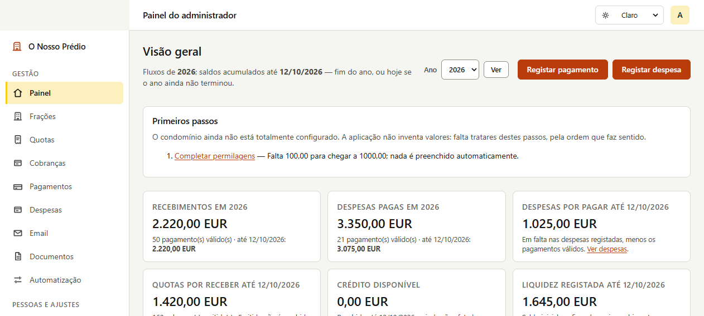
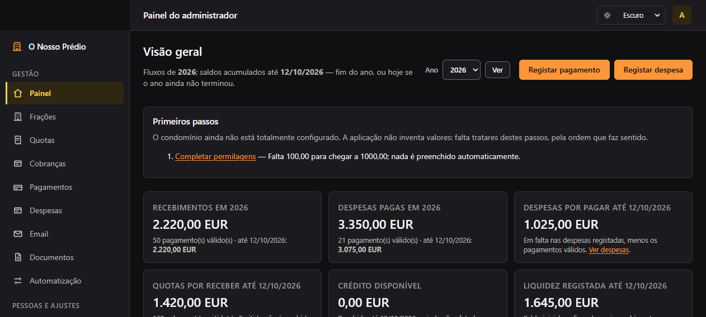
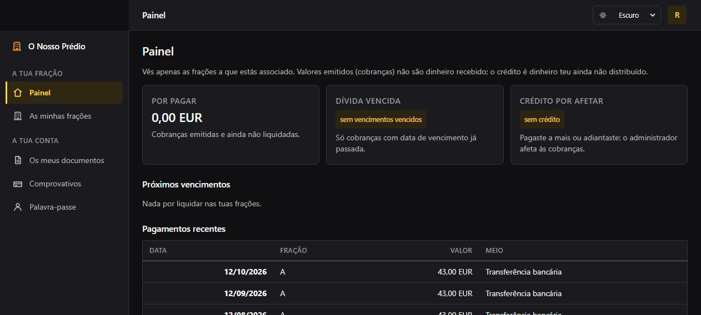
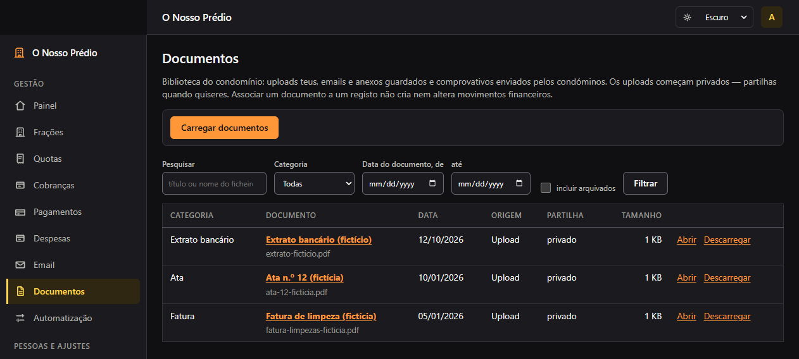
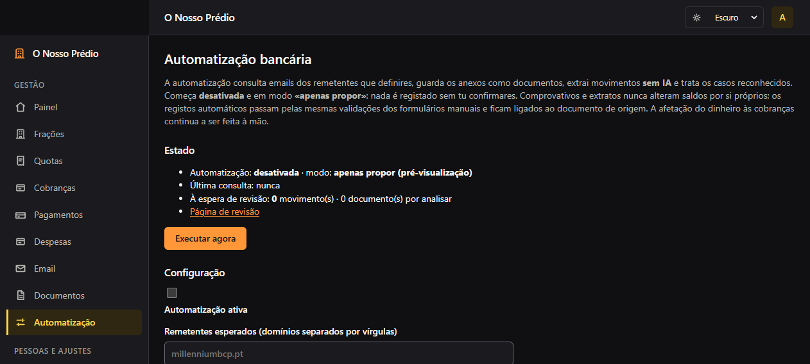

# O Nosso Prédio

Aplicação web local para gestão de um condomínio português: frações e permilagens,
regras de quota, cobranças mensais, pagamentos e dívidas por condómino, despesas,
documentos, portal do condómino e — opcionalmente — leitura de e-mails Gmail e
extratos bancários.

Corre no teu computador (ou num servidor da rede local), com uma base SQLite.
Não há serviços cloud obrigatórios: o Gmail e a IA são integrações opcionais que o
administrador configura ele próprio.

Uma instalação nova **começa vazia**: sem frações, sem quotas, sem movimentos.
Tudo o que existe num condomínio — identificação, frações, permilagens, valores,
datas — é configurado pelo administrador através da interface.

## Funcionalidades implementadas

- **Administração** — utilizadores (administrador e condómino), primeiro
  administrador criado num percurso protegido, gestão de contas e palavras-passe.
- **Frações e permilagens** — criar, identificar (código curto), desativar e
  eliminar frações; a soma das permilagens é validada e uma repartição incompleta
  mostra quanto falta, sem nunca ser completada automaticamente.
- **Regras de quota** — rubricas (quota ordinária, reforço do fundo, outras),
  valores por fração, vigência por meses, sobreposições recusadas, correção de
  cobranças emitidas com motivo registado.
- **Cobranças** — pré-visualização e geração mensal idempotente, vencimentos
  configuráveis, correção justificada.
- **Pagamentos e afetações** — registo de recebimentos, afetação a cobranças
  (parciais, múltiplos pagamentos, múltiplas cobranças), créditos por afetar,
  anulação com motivo (nunca apaga), edição com revisão de concorrência.
- **Portal do condómino** — cada condómino vê as suas cobranças, dívida,
  pagamentos e documentos próprios.
- **Despesas** — categorias, despesas com classificação (ordinário / fundo de
  reserva), pagamentos parciais com limite, anulação, revisões.
- **Dashboard financeiro** — fluxo do período vs. saldos acumulados, dívida
  vencida, liquidez estimada (com aviso de que não é saldo bancário reconciliado),
  decomposição do fundo de reserva, gráficos por mês.
- **Documentos** — biblioteca com upload, versões, categorias, metadados de ata;
  ficheiros guardados fora da pasta pública, com acesso mediado pela aplicação.
- **Gmail (opcional)** — leitura de e-mails via OAuth (âmbito `gmail.readonly`),
  visualização de mensagens e anexos, guarda de anexos como documentos.
- **Automatização bancária (opcional)** — ciclo Gmail → extrato → extração de
  movimentos → correspondências → registo ou proposta, com revisão manual
  obrigatória e prevenção de duplicados.
- **IA (opcional)** — resumo/classificação de documentos através de uma API
  compatível com OpenAI que o administrador configura (pode ser um modelo local).
- **OCR local (opcional)** — páginas sem camada de texto passam por Tesseract,
  quando instalado; sem ele, vão para revisão.

## Capturas de ecrã

| Painel do administrador (tema claro) | Painel do administrador (tema escuro) |
|---|---|
|  |  |

| Portal do condómino | Biblioteca de documentos | Automatização bancária |
|---|---|---|
|  |  |  |

As imagens são da **base de demonstração** (dados fictícios), não de um condomínio real.

## Requisitos

- Python 3.11 ou mais recente (desenvolvido e testado com 3.12/3.13).
- Sistema operativo: Windows ou Linux (Ubuntu).
- Sem bases de dados externas: SQLite faz parte do Python.

## Instalação e arranque

### Windows

```powershell
cd "pasta\do\projeto"
py -m venv .venv
.venv\Scripts\python.exe -m pip install -r requirements.txt
.venv\Scripts\python.exe run.py
```

### Ubuntu

```bash
cd pasta/do/projeto
python3 -m venv .venv
.venv/bin/python -m pip install -r requirements.txt
.venv/bin/python run.py
```

A aplicação abre em `http://127.0.0.1:5000`. A base fica em `instance/condominio.db`
e é criada automaticamente no primeiro arranque (ou antes, com
`python run.py initdb`).

## Primeiro arranque: administrador e primeiros passos

1. Abrir `http://127.0.0.1:5000` — enquanto não existem utilizadores, a aplicação
   apresenta o percurso **«Criar o primeiro administrador»**. Não há palavra-passe
   predefinida nem contas de demonstração numa instalação normal.
2. Criar o administrador.
3. O painel mostra um **«Primeiros passos»** com o que falta:
   - **Configurar o condomínio** — nome, morada, data de início da gestão e dia
     de vencimento das quotas (Configuração).
   - **Criar frações** — com as permilagens reais do condomínio (Frações). A soma
     pode ficar incompleta durante a configuração: a aplicação diz quanto falta e
     nunca preenche o resto por ti.
   - **Registar regras de quota** — valores e vigências decididos em assembleia
     (Quotas).
   - **Gerar a primeira cobrança** — pré-visualizar e confirmar mês a mês
     (Quotas → Gerar mês).

## Demonstração opcional (dados fictícios)

Para explorar a aplicação sem configurar nada:

```bash
python run.py demo            # cria instance/demo.db (e instance/demo_instance/)
python run.py serve --demo    # serve essa base em 127.0.0.1:5000
```

A demonstração cria um condomínio inventado («Condomínio das Acácias») com
frações, permilagens, regras, cobranças, pagamentos, despesas e documentos PDF
fictícios. As contas de acesso da demonstração são:

- `demo.admin` / `palavra-de-demonstracao-2026` (administrador)
- `demo.condomino` / `palavra-de-demonstracao-2026` (condómino da fração A)

A demonstração **nunca** é criada pelo arranque normal e **nunca** escreve na base
real: usa sempre uma base e uma pasta de instância próprias ao lado de
`instance/demo.db`. Se a base de demonstração já tiver dados, o comando recusa
sobrescrevê-la.

## Integração Gmail (opcional)

O Gmail é lido com OAuth criado por ti na consola do Google Cloud; a aplicação só
usa o âmbito de leitura (`gmail.readonly`):

1. Em [console.cloud.google.com](https://console.cloud.google.com), criar um
   projeto e ativar a API Gmail.
2. Criar um **cliente OAuth (tipo: Web)** para uma aplicação de computador e
   adicionar o URI de redirecionamento `http://127.0.0.1:5000/email/oauth/callback`
   (ou o endereço onde a aplicação correr).
3. Em **Definições → Integrações**, preencher o *client id* e o *client secret* e
   clicar em **Ligar conta Gmail** — o navegador abre o consentimento do Google e
   o *refresh token* fica guardado na base local.
4. A página **E-mail** lista mensagens de remetentes configurados; anexos podem
   ser guardados como documentos do condomínio.

Nenhum segredo é mostrado no navegador depois de guardado. As chaves ficam na
tabela `integracoes` da base local — por isso a base é dado pessoal e entra nos
backups, nunca no repositório Git.

## IA opcional

Em **Definições → Integrações** pode configurar uma API compatível com OpenAI
(pode ser um servidor local, por exemplo llama.cpp ou Ollama):

- `Base URL` (por exemplo `http://127.0.0.1:11434/v1`)
- `Modelo`
- `Chave API` (se o servidor a exigir)
- `Timeout` em segundos

A IA é sempre opcional: sem ela, a aplicação funciona por inteiro. Os textos
enviados à API são os documentos carregados pelo administrador; nenhuma chamada é
feita sem a integração ativa.

## Automatização bancária

Página **Automatização** (`/automacao`), com um ciclo:

1. Procura e-mails de remetentes configurados (domínios bancários) desde uma data
   configurada.
2. Extrai movimentos de PDFs de extrato (PyMuPDF como leitor principal, pypdf como
   recurso, OCR local quando existe).
3. Compara cada movimento com as **correspondências** definidas pelo administrador
   (IBAN, nome do ordenante ou referência → fração ou fornecedor).
4. Consoante o modo:
   - **Proposta** (predefinição): o movimento fica na fila de **revisão**
     (`/automacao/revisao`) para o administrador confirmar;
   - **Registo automático**: só para correspondências únicas e e-mails com SPF e
     DKIM validados.
5. Duplicados são travados na base: cada movimento tem um `hash` único — repetir
   o extrato não cria pagamentos nem despesas duas vezes.

O ciclo pode ser agendado:

```bash
python run.py processar-bancario
```

Modo «proporção»: um pagamento global do extrato pode ser distribuído
proporcionalmente pelas cobranças em dívida de uma fração, mas a distribuição é
sempre revista antes de ficar registada.

## OCR (opcional)

A extração lê PDFs com camada de texto. Para páginas digitalizadas (sem texto):

1. Instalar o binário **Tesseract** no sistema:
   - Ubuntu: `sudo apt install tesseract-ocr`
   - Windows: instalador UB-Mannheim.
2. Descomentar `pytesseract` e `Pillow` em `requirements.txt` e reinstalar.

Sem Tesseract instalado, documentos sem texto útil não rebentam: ficam marcados
para revisão manual. A qualidade do OCR depende da digitalização — valores
extraídos por OCR passam sempre pela revisão do administrador.

## Backup e restauro

- **Backup**: `python scripts/backup_local.py` — copia a base com a API de backup
  do SQLite (consistente mesmo com a aplicação a correr), copia
  `instance/documentos` e verifica a cópia com `PRAGMA quick_check`. As cópias
  ficam em `backups/` (fora do Git).
- **Restauro**: parar a aplicação, repor `condominio.db` e a pasta `documentos`
  na `instance/`, voltar a arrancar. Não há migrações destrutivas: o esquema evolui
  por migrações aditivas que preservam os dados existentes.

## Testes

```bash
python -m pip install -r requirements-dev.txt
python -m pytest tests
```

A suite cobre as regras financeiras (afetações, anulações, créditos, saldos),
concorrência entre janelas abertas, proteção de formulários, permissões por papel
e o comportamento de uma instalação nova (começa vazia).

## Limitações conhecidas (honestas)

- O servidor é o servidor de desenvolvimento do Flask, ligado a `127.0.0.1`.
  Serve para uso local e testes; **não** está endurecido para exposição pública.
  Uma implantação futura precisaria de um servidor WSGI próprio, HTTPS e
  endurecimento do sistema.
- Não é software certificado de contabilidade: não faz escrituração dupla nem
  reconciliação bancária automática. Os saldos do painel são estimativas a partir
  do que foi registado.
- A automatização bancária não abre contas nem movimenta dinheiro: lê e propõe.
- A extração de extratos depende do formato do PDF; extratos muito diferentes dos
  testados vão para revisão manual.
- A IA é opcional e pode estar errada: as propostas precisam de revisão.
- Não há importação de históricos de outros sistemas.

## Licença

MIT — ver [LICENSE](LICENSE). O projeto pode ser usado, copiado e modificado
livremente, mantendo a atribuição ao autor.
